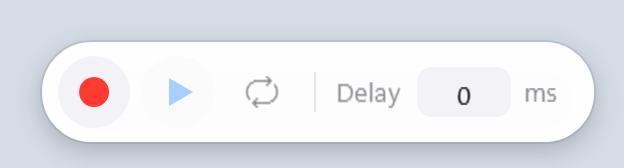
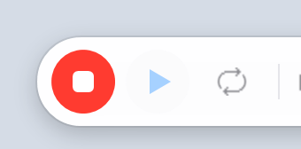
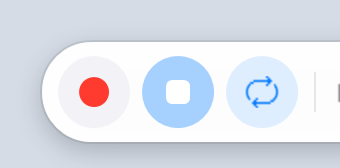
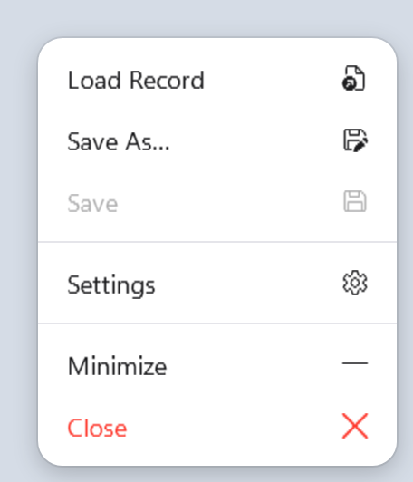
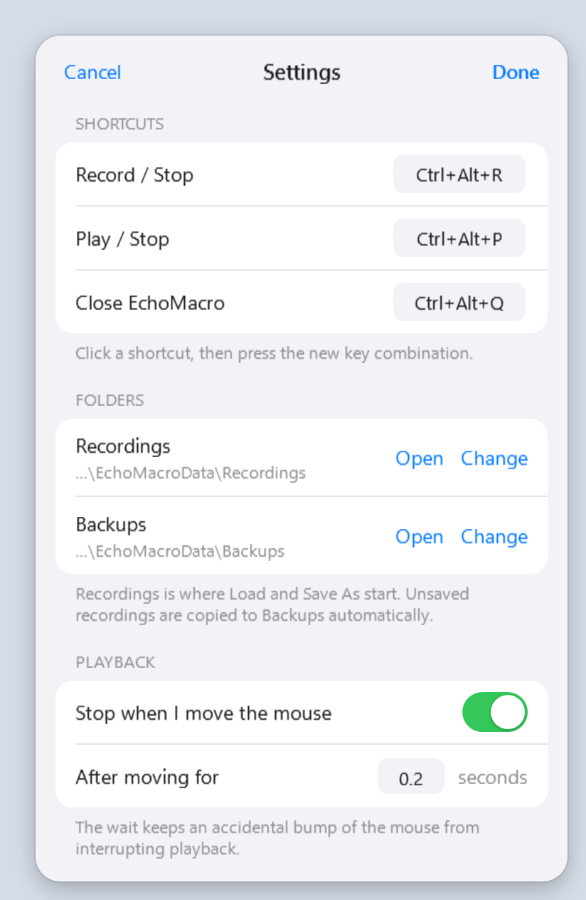

<h1 align="center">EchoMacro</h1>

<p align="center">
  A tiny always-on-top toolbar for Windows that records what you do with the mouse and keyboard,<br>
  and plays it back.
</p>

<p align="center">
  
</p>

## Download

**[Download EchoMacro.exe](https://github.com/MortCat/EchoMacro/releases/latest/download/EchoMacro.exe)** (Windows 10/11, 64-bit, about 70 MB)

One file, nothing to install. The .NET runtime is bundled, so it runs on a machine that has never had .NET
on it. Put the file in a folder of its own and double-click it; EchoMacro keeps its settings and
recordings in an `EchoMacroData` folder next to it.

Older versions and release notes are on the [Releases](https://github.com/MortCat/EchoMacro/releases) page.

> **First run.** The file is not code-signed, so Windows SmartScreen may show "Windows protected your PC".
> Choose **More info**, then **Run anyway**. Some antivirus products are also wary of any program that
> listens to and simulates input, which is exactly what a macro recorder does.

## Features

- **Records real input.** Key presses and releases, all five mouse buttons, the wheel, and the path of
  drags, with their original timing.
- **Key combinations and drags replay correctly.** `Ctrl+C`, `Shift`+arrows, `Alt+Tab`, drag and drop,
  double clicks.
- **Human-like cursor movement.** Between clicks the cursor travels along a curve, speeds up and slows
  down, and now and then misses slightly and corrects.
- **Global hotkeys.** Record, play and stop from any application, without touching the toolbar. All three
  are configurable.
- **Take the mouse back to stop.** Keep moving the real mouse during playback and it stops.
- **Repeat and delay.** Loop a recording until stopped; add a wait before every action.
- **Nothing gets lost.** A recording you never saved is backed up automatically before it is replaced.
- **Stays out of the way.** Three buttons, or no window at all: it minimizes to the notification area
  with the hotkeys still working.
- **Plain JSON recordings.** Readable, editable, easy to keep under version control.

## How to use

### 1. Record



Click the **red dot**, or press `Ctrl+Alt+R`. The button turns red while recording.

Do what you want to automate, then click the button or press `Ctrl+Alt+R` again to stop.

Clicks on EchoMacro itself are never recorded, and neither is the hotkey you stop with. Starting a new
recording replaces the current one; if you had not saved it, a copy goes to the backups folder first.

<br clear="right">

### 2. Play



Click the **blue triangle**, or press `Ctrl+Alt+P`. The same button or hotkey stops it.

The play button is unavailable until there is something to play: record something or load a file.

To stop without the hotkey, take the mouse back. Moving the real mouse continuously for a moment
(0.2 seconds by default) stops playback; a single bump does not.

<br clear="right">

### 3. Repeat and delay


- Click the **loop icon** to repeat the recording until you stop it. It turns blue when on.
- Rest the pointer on the loop icon and the **Delay** field slides out. The value is an extra wait, in
  milliseconds, before every action. Any value above 0 also slows cursor movement to a more human pace.

### 4. Save and load



**Right-click the toolbar** for the menu.

- **Load Record** opens a saved recording.
- **Save As…** writes the current recording to a new file.
- **Save** writes back to the file you loaded or last saved to.
- **Settings** opens the settings window.
- **Minimize** hides the toolbar into the notification area. The hotkeys keep working. Click the tray
  icon to bring the toolbar back; its tooltip shows whether EchoMacro is ready, recording or playing.
- **Close** exits.

Drag the toolbar anywhere on screen. Its position, the delay and the repeat setting are remembered.

<br clear="right">

### 5. Settings



**Shortcuts.** Click a shortcut, then press the new combination. Because the hotkeys work in every
application, each needs at least one of Ctrl, Alt, Shift or Win (function keys are allowed on their own).
If another program already uses a combination, EchoMacro tells you and you can pick a different one.

**Folders.** *Recordings* is where Load and Save As start. *Backups* receives the automatic copies of
unsaved recordings; the 10 most recent are kept. **Open** shows a folder in Explorer, **Change** moves it.

**Playback.** Turn "stop when I move the mouse" on or off, and set how long the movement has to last
before playback stops.

<br clear="right">

## Default hotkeys

| Hotkey | Action |
|---|---|
| `Ctrl+Alt+R` | Start / stop recording |
| `Ctrl+Alt+P` | Play / stop playback |
| `Ctrl+Alt+Q` | Close EchoMacro |

## Good to know

**What is recorded**

- Key presses and releases, including the repeats from holding a key down.
- Presses and releases of the left, right, middle and both side mouse buttons.
- The cursor path while a button is held (drags), and wheel scrolling.

The cursor path while no button is held is *not* recorded. Playback generates that movement itself and
arrives at each recorded position at the recorded time.

**Where files go**

```
EchoMacroData/          next to EchoMacro.exe
├── settings.json
├── Recordings/
└── Backups/
```

If that location is not writable, `%LocalAppData%\EchoMacro` is used instead.

**Safety**

- A recording is **plain text**. Anything you type while recording, passwords included, ends up in the
  file. Do not record yourself signing in.
- Playing a recording **sends real input to your computer**. Only load recordings you trust.

## Build from source

Requires the [.NET 8 SDK](https://dotnet.microsoft.com/download/dotnet/8.0) on Windows.

```
dotnet build EchoMacro.sln -c Release
```

To produce the single self-contained `EchoMacro.exe` offered under Download:

```
dotnet publish EchoMacro/EchoMacro.csproj -c Release -r win-x64 --self-contained true -p:PublishSingleFile=true -p:IncludeNativeLibrariesForSelfExtract=true -p:EnableCompressionInSingleFile=true -p:DebugType=none -o publish
```

### Project layout

```
EchoMacro/
├── MainWindow.xaml(.cs)          Toolbar window, hotkeys, tray icon, record/play wiring
├── Service/
│   ├── Recorder.cs               Global input hooks -> list of RecordedAction
│   ├── Player.cs                 Replays a list of RecordedAction
│   ├── RecordedAction.cs         The recorded action model (JSON schema)
│   ├── GlobalHotKeyManager.cs    Win32 RegisterHotKey wrapper
│   ├── TreeViewController.cs     Load / save / backup and the other menu actions
│   └── AppSettings.cs            Settings model and the data folder
├── View/
│   ├── FileItemTreeView_UserControl.xaml(.cs)   Right-click context menu
│   └── SettingsWindow.xaml(.cs)                 Shortcuts, folders, auto-stop
├── Themes/
│   └── Ios.xaml                  Colors and control styles shared by all windows
└── Library/
    └── NativeInput.cs            Win32 SendInput wrapper for simulated keys and mouse buttons
```

Recording uses [MouseKeyHook](https://github.com/gmamaladze/globalmousekeyhook).
